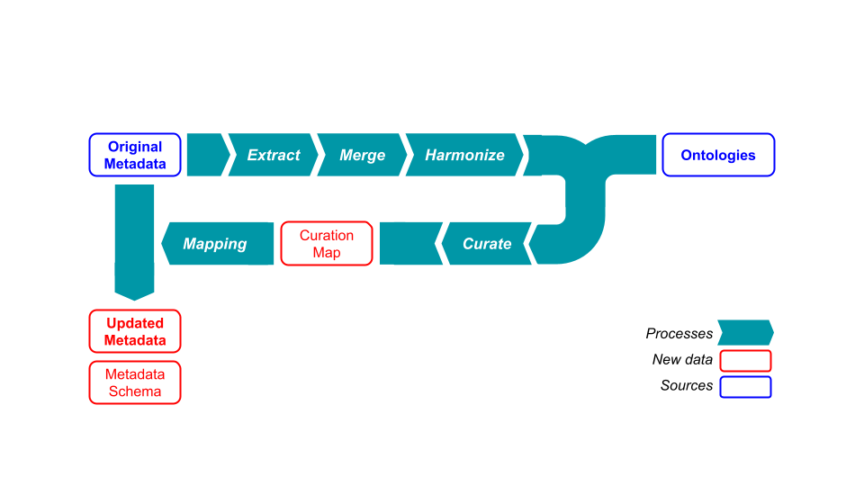

# OmicsMLRepo project

Clinical and epidemiological data tend to explain most of the variation of 
health-related traits, and its joint modeling with Omics data is crucial to 
increase the algorithm’s predictive ability. However, the nature of non-Omics 
data, such as heterogeneity, lack of standardization, high complexity, and 
loose links to Omics data types, make it hard to use both Omics and non-Omics 
data for ML analyses.

OmicsMLRepo project aims to build the first large-scale, platform-independent, 
curated, ML-ready data repository for diverse Omics and associated non-Omics 
data, starting from two Bioconductor data packages - [curatedMetagenomicData] 
containing human microbiome data and [cBioPortalData] package on cancer 
genomics data. 

This repository, OmicsMLRepoData, documents the hamonization/curation 
processes and the artifacts generated throughout. We are also developing a 
software package, [OmicsMLRepoR], allowing users to leverage ontology in 
metadata search. 

In summary, the OmicsMLRepo project simplifies the process of cross-study, 
multi-faceted data analyses through metadata harmonization and standardization, 
making Omics data more AI/ML-ready. 

> **Data dictionaries are frozen here (2026-11-24).** The cBioPortal and
> curatedMetagenomicData data dictionaries in [`inst/extdata/`](inst/extdata/)
> are no longer updated in this repository. They are maintained, versioned and
> released as target schemas in
> [MetaHarmonizerSchemaRegistry](https://github.com/shbrief/MetaHarmonizerSchemaRegistry):
>
> | Here (frozen) | Maintained as |
> |---|---|
> | `inst/extdata/cBioPortal_data_dictionary.csv` | `schema/omicsmlrepo_cbio/omicsmlprepo_cbio_schema.csv` |
> | `inst/extdata/cMD_data_dictionary.csv` | `schema/curatedmetagenomicdata/cmd_schema.csv` |
>
> The Google Sheets these files were synced from are no longer the source of
> truth; the sync code is commented out. To change a dictionary, open a pull
> request in the registry. To reproduce the OmicsMLRepo paper, use release
> `v1.0.0` of this repository and the data on Zenodo
> ([10.5281/zenodo.14110745](https://doi.org/10.5281/zenodo.14110745)). See
> [`inst/extdata/README.md`](inst/extdata/README.md) for details.

[curatedMetagenomicData]: https://bioconductor.org/packages/release/data/experiment/html/curatedMetagenomicData.html
[cBioPortalData]: https://bioconductor.org/packages/release/bioc/html/cBioPortalData.html 
[OmicsMLRepoR]: https://github.com/shbrief/OmicsMLRepoR 

<br>



### Hamonized metadata
You can access the harmonized version of metadata using the 
`OmicsMLRepoR::getMetadata` function:

```
if (!require("devtools"))
    install.packages("devtools")
devtools::install_github("shbrief/OmicsMLRepoR")

library(OmicsMLRepoR)
cmd <- getMetadata("cMD")
cbio <- getMetadata("cBioPortal")
```
